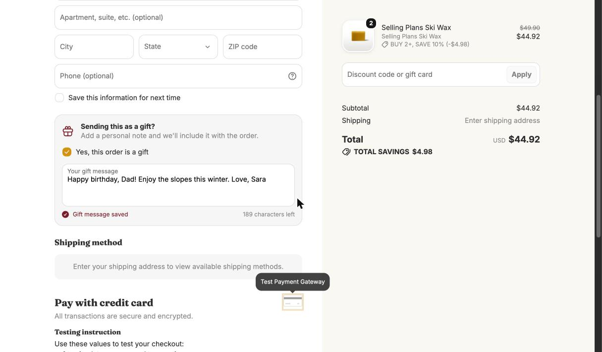
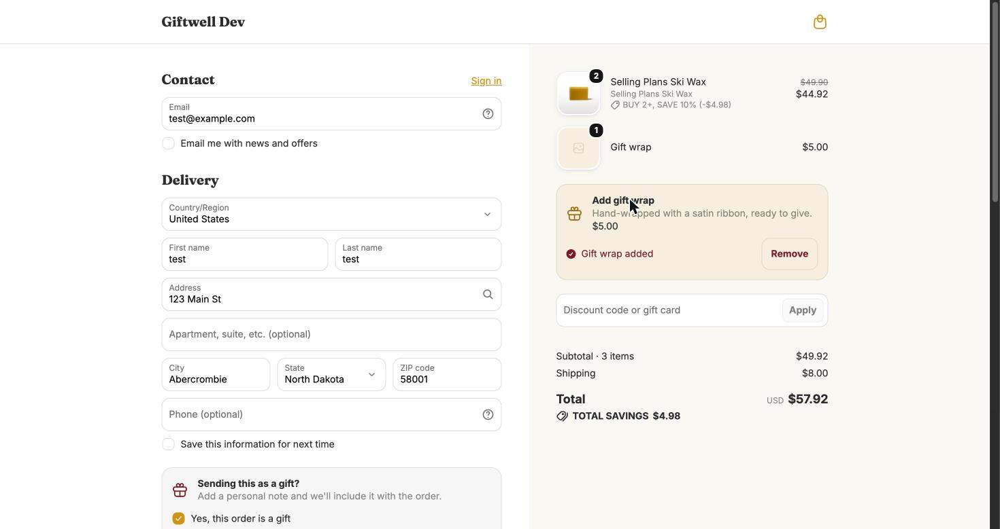
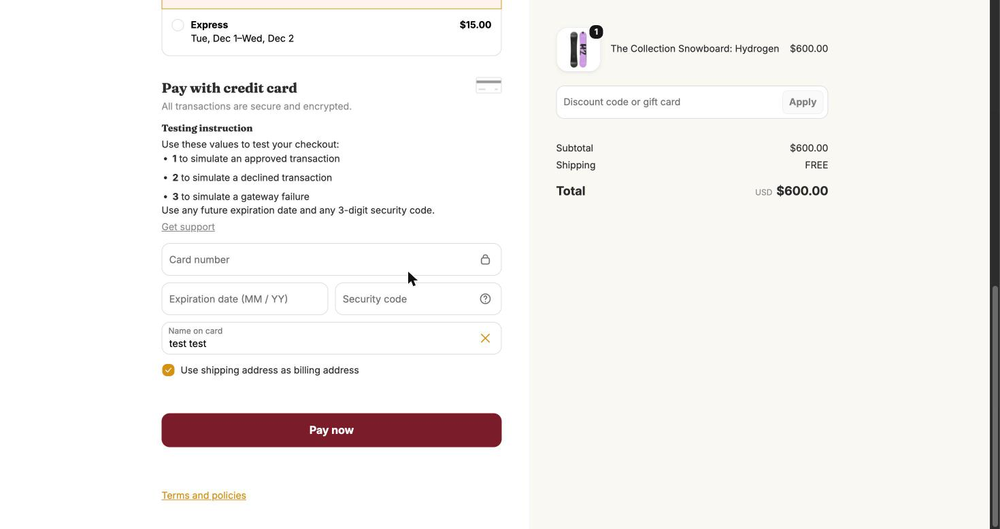
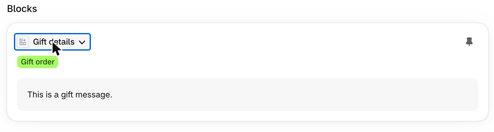
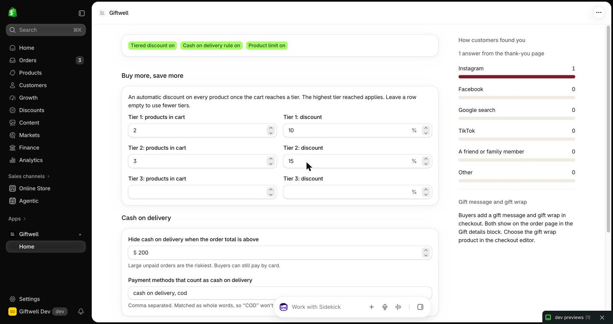
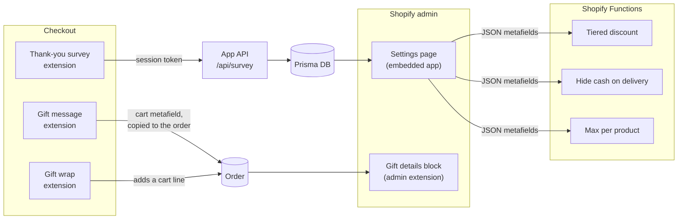

# Giftwell

A Shopify app that turns a standard checkout into a gifting checkout, built with **Checkout UI extensions**, **Shopify Functions** and an **admin UI extension**.



Every feature below was built and tested with real test orders on a Shopify Plus development store. The whole build, including every bug found along the way, is written up in the [build journal](docs/journal/BUILD-JOURNAL.md).

## What it does

| Feature | Where | Built with |
|---|---|---|
| Gift message, saved to the order | Checkout, after the delivery address | Checkout UI extension + cart-to-order metafield |
| "Add gift wrap for $5" | Checkout, under the cart lines | Checkout UI extension + Storefront API |
| Buy 2 get 10%, buy 3+ get 15% (configurable) | Cart and checkout | Function: Discount API |
| Hide cash on delivery above a set order total | Payment step | Function: Payment Customization API |
| Max 5 of any product per order (all variants count) | Cart and checkout | Function: Cart and Checkout Validation API |
| "How did you hear about us?" | Thank-you page | Checkout UI extension + app API + Prisma |
| Gift message and gift wrap on the order page | Shopify admin | Admin UI extension (order details block) |
| Settings for every rule, plus survey results | Shopify admin | Embedded app (React Router, Polaris, App Bridge) |

<table>
<tr>
<td><br><sub>Gift wrap added. The discount still counts only the wax.</sub></td>
<td><br><sub>Cash on delivery hidden on a $600 order.</sub></td>
</tr>
<tr>
<td><br><sub>Gift details on the admin order page.</sub></td>
<td><br><sub>Settings page with survey results.</sub></td>
</tr>
</table>

## How it fits together



**Settings without redeploys.** Each Function reads its configuration from a JSON metafield on its owner (the discount, the payment customization, the validation). The settings page writes those metafields with `metafieldsSet`, so a change applies to the next checkout. Example: adding a 5+ tier at 20% on the settings page took effect on the very next cart.

**Data from checkout to the order.** Cart attributes are deprecated for this, so the gift message is a cart metafield (`$app.gift_message`). An order metafield definition with `cart_to_order_copyable = true` copies it onto the order when it's placed, where the admin block shows it.

**Checkout to app server.** The thank-you page can't write to the order, so the survey sends answers to the app with Shopify's checkout session token. The route verifies it with `authenticate.public.checkout`, takes the shop from the token (never from the request body), and stores one answer per order.

**Rules that don't trip over each other.** Gift wrap is tagged `giftwell-exclude`, so the discount Function never counts it towards a tier. The cash on delivery rule matches whole words, so "COD" never hides a method called "Barcode Pay".

## Tests

```bash
# Function tests: each fixture cart runs against the compiled WebAssembly
cd extensions/tiered-discount && npx vitest run   # 5 tests
cd extensions/hide-cod && npx vitest run          # 5 tests
cd extensions/max-per-product && npx vitest run   # 5 tests

# Settings validation unit tests
npx vitest run app/lib                            # 7 tests

# Rust port of max-per-product (needs Rust + the wasm32-unknown-unknown target)
cd extensions/max-per-product-rust && npx vitest run   # the same 5 tests
```

### JavaScript vs Rust

`extensions/max-per-product-rust` is a Rust port of the max-per-product Function with identical output, kept to compare the two languages. Instruction counts from `shopify app function run` (Shopify's limit is 11 million for carts up to 200 lines):

| Cart | JavaScript | Rust |
|---|---|---|
| 3 lines, 1 product over the limit | 312,506 | 42,961 (~7.3x fewer) |
| 200 lines, 40 products over the limit | 6,993,307 | 3,382,036 (~2.1x fewer) |

The Function fixtures also check each sample cart against Shopify's schema. On a live checkout the discount Function runs in about 0.36 million instructions.

## Project structure

```
app/
  routes/app._index.tsx      Settings page and survey results
  routes/api.survey.tsx      Survey endpoint (checkout session token)
  lib/settings.ts            Settings parsing and validation (+ tests)
  lib/giftwell.server.ts     Reads and writes each Function's metafield
extensions/
  tiered-discount/           Function: Discount API
  hide-cod/                  Function: Payment Customization API
  max-per-product/           Function: Cart and Checkout Validation API
  max-per-product-rust/      The same Function in Rust, for a speed comparison
  gift-message/              Checkout UI extension
  gift-wrap-upsell/          Checkout UI extension
  thank-you-survey/          Checkout UI extension (thank-you page)
  gift-message-admin/        Admin UI extension (order details block)
docs/
  journal/BUILD-JOURNAL.md   The full build, phase by phase, with screenshots
  checkout-branding.graphql  Brands a Plus checkout (colours and fonts)
```

## Run it yourself

You need Node 20+, Shopify CLI and a Shopify Plus development store (checkout extensions on the information, shipping and payment steps need Plus).

```bash
npm install
shopify app dev --store your-dev-store.myshopify.com
```

Then, in the Dev Dashboard (Apps → your app → Settings → Access requests):
- enable **Network access** (the thank-you survey calls the app), and
- request **Protected customer data**, customer data only (the admin block reads orders).

Open the app in your store's admin and click **Save** once: it creates the discount, the payment customization and the validation with default settings. Checkout extensions render in development through the Dev Console's preview link.

If the Cloudflare tunnel fails, `shopify app dev --use-localhost` works for everything here. Shopify can't send webhooks to localhost, so the template's two webhook subscriptions are paused in `shopify.app.toml` and need adding back before deploying.

## Author

Built by [Umer J.](https://umerconnects.com), Shopify developer. Read the [case study](https://umerconnects.com/work/giftwell-shopify-checkout-extensibility) or the [build journal](docs/journal/BUILD-JOURNAL.md).
