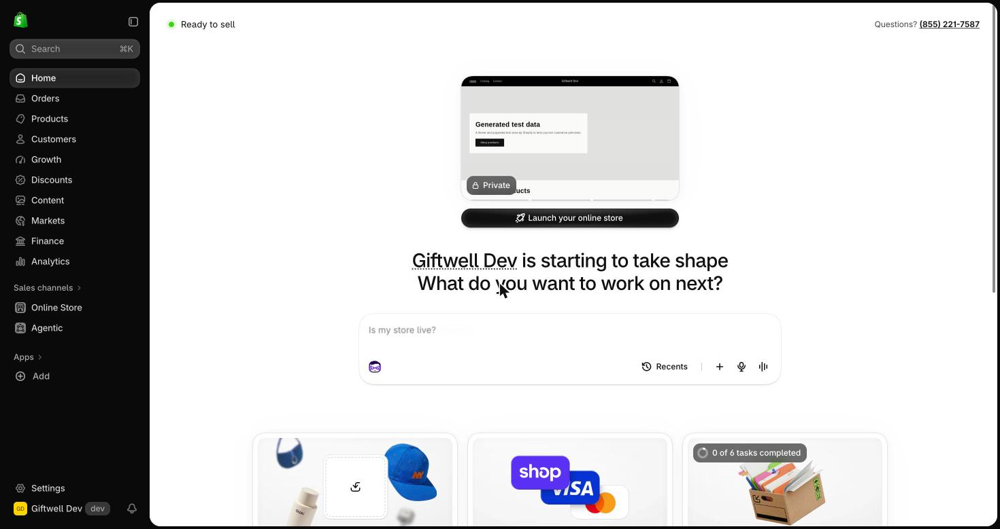

# Giftwell build journal

A running log of how Giftwell was built: decisions, steps, problems and screenshots. It is the raw material for the case study on umerconnects.com and the CV entry.

- **What:** a Shopify app that turns a standard checkout into a gifting checkout, using Checkout UI extensions and Shopify Functions.
- **Who:** Umer J., built with Claude Code as the AI pair, every step reviewed and tested by me.
- **Where:** dev store `giftwell-dev.myshopify.com` (Shopify Plus dev store with demo data).

## The plan

| # | Piece | Shopify feature | Phase |
|---|---|---|---|
| 1 | Gift message saved to the order | Checkout UI extension | 2 |
| 2 | "Add gift wrap for $5" upsell | Checkout UI extension | 4 |
| 3 | Buy 2 get 10% off, buy 3+ get 15% off | Function: Discount API | 2 |
| 4 | Hide Cash on Delivery over a set amount | Function: Payment Customization | 3 |
| 5 | Max 5 of any product per order | Function: Cart and Checkout Validation | 3 |
| 6 | "How did you hear about us?" on the thank-you page | Checkout UI extension | 4 |
| 7 | Admin settings page, stored in metafields and read by the Functions | Embedded app page (Polaris) | 5 |

Phase 6 is the showcase: README, a 60-second video per piece and the case study.

---

## Phase 1: Foundation (26 Nov 2026)

### 1. Separate the accounts
I work on Shopify both as a freelancer and at an agency (BlueNest), so the first step was keeping the two logins apart in Shopify CLI:

- Renamed the existing agency login to the alias `bluenest`.
- Logged in with my personal account and named it `personal`.
- Every command for this project runs with `--auth-alias personal`.

**Why it matters:** with two accounts on one machine, it is easy to create an app or a store in the wrong organisation. Named aliases make the account explicit in every command.

### 2. A dev store on the Plus plan
Checkout UI extensions on the information, shipping and payment steps need Shopify Plus. A Plus dev store gives the full checkout for free, with demo products to test against.

```bash
shopify store create dev --name "Giftwell Dev" --organization-id <org> \
  --plan plus --demo-data --country US
```

Result: `giftwell-dev.myshopify.com`, ready in under 10 seconds.




### 3. Scaffold the app
Shopify's React Router template in TypeScript, created without interactive prompts so the step is repeatable:

```bash
shopify app init --name Giftwell --organization-id <org> \
  --template reactRouter --flavor typescript --auth-alias personal
```

What the template gives: an embedded admin app (React Router + Polaris), OAuth and session storage (Prisma + SQLite), webhooks, and an `extensions/` folder where the checkout extensions and Functions will live.

### Notes for later
- The template ships demo config (an example metaobject, a product metafield, a product price-change event and broad product scopes). It will be replaced with Giftwell's real scopes in phase 2: discounts, payment customizations and validations.
