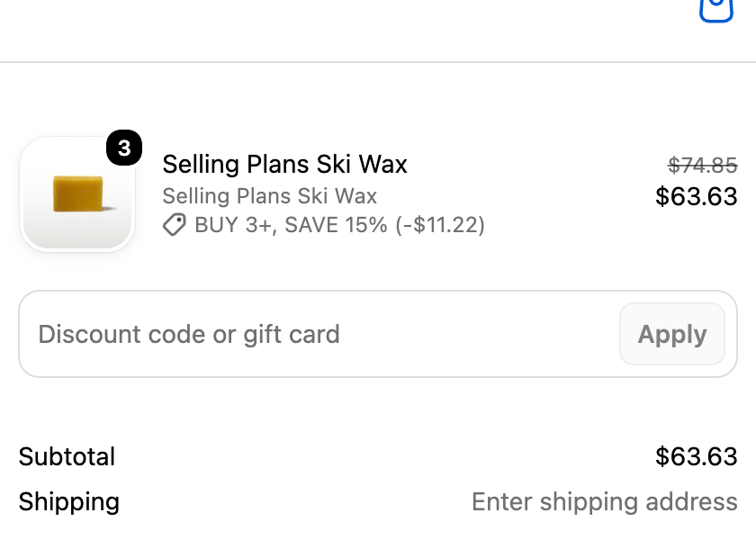

# Giftwell build journal

A running log of how Giftwell was built: decisions, steps, problems and screenshots. It is the raw material for the case study on umerconnects.com and the CV entry.

- **What:** a Shopify app that turns a standard checkout into a gifting checkout, using Checkout UI extensions and Shopify Functions.
- **Who:** Umer J., built with Claude Code as the AI pair, every step reviewed and tested by me.
- **Where:** dev store `giftwell-dev.myshopify.com` (Shopify Plus dev store with demo data).

## The plan

| # | Piece | Shopify feature | Phase |
|---|---|---|---|
| 1 | Gift message saved to the order | Checkout UI extension | 2 |
| 2 | "Add gift wrap for $5" upsell | Checkout UI extension | 4 |
| 3 | Buy 2 get 10% off, buy 3+ get 15% off | Function: Discount API | 2 |
| 4 | Hide Cash on Delivery over a set amount | Function: Payment Customization | 3 |
| 5 | Max 5 of any product per order | Function: Cart and Checkout Validation | 3 |
| 6 | "How did you hear about us?" on the thank-you page | Checkout UI extension | 4 |
| 7 | Admin settings page, stored in metafields and read by the Functions | Embedded app page (Polaris) | 5 |

Phase 6 is the showcase: README, a 60-second video per piece and the case study.

---

## Phase 1: Foundation (26 Nov 2026)

### 1. Separate the accounts
I work on Shopify both as a freelancer and at an agency (BlueNest), so the first step was keeping the two logins apart in Shopify CLI:

- Renamed the existing agency login to the alias `bluenest`.
- Logged in with my personal account and named it `personal`.
- Every command for this project runs with `--auth-alias personal`.

**Why it matters:** with two accounts on one machine, it is easy to create an app or a store in the wrong organisation. Named aliases make the account explicit in every command.

### 2. A dev store on the Plus plan
Checkout UI extensions on the information, shipping and payment steps need Shopify Plus. A Plus dev store gives the full checkout for free, with demo products to test against.

```bash
shopify store create dev --name "Giftwell Dev" --organization-id <org> \
  --plan plus --demo-data --country US
```

Result: `giftwell-dev.myshopify.com`, ready in under 10 seconds.


### 3. Scaffold the app
Shopify's React Router template in TypeScript, created without interactive prompts so the step is repeatable:

```bash
shopify app init --name Giftwell --organization-id <org> \
  --template reactRouter --flavor typescript --auth-alias personal
```

What the template gives: an embedded admin app (React Router + Polaris), OAuth and session storage (Prisma + SQLite), webhooks, and an `extensions/` folder where the checkout extensions and Functions will live.

### Notes for later
- The template ships demo config (an example metaobject, a product metafield, a product price-change event and broad product scopes). It will be replaced with Giftwell's real scopes in phase 2: discounts, payment customizations and validations.

---

## Phase 2: Gift message + tiered discount (26 Nov 2026)

### Tiered discount (Shopify Function, Discount API)
Scaffolded with Shopify CLI (`shopify app generate extension --template discount --flavor vanilla-js`), then trimmed to the one target it needs: `cart.lines.discounts.generate.run`. The scaffold also adds a shipping-discount target, which I removed.

How it works:
1. The input query asks for each cart line's quantity, whether the product is tagged `giftwell-exclude` (via `hasAnyTag`), and the discount's configuration metafield (`$app.function-configuration`).
2. The Function adds up the units of every eligible product, picks the highest tier reached, and returns a `productDiscountsAdd` operation for every eligible line.
3. Tiers come from the metafield, e.g. `{"tiers":[{"minQuantity":2,"percentage":10},{"minQuantity":3,"percentage":15}]}`. If the metafield is missing it falls back to 10% and 15%. That is what lets the phase 5 settings page change the tiers without redeploying code.

Tested with 5 fixture carts run against the compiled WebAssembly through Shopify's function runner. Each test also checks the input against Shopify's schema:

| Test cart | Expected |
|---|---|
| 1 item | no discount |
| 2 units | 10% off |
| 3 units, one product excluded | 15% off the 2 eligible lines only |
| 4 units, custom tiers in the metafield | 25% off (custom tier) |
| discount without the product class | no discount |

### Gift message (Checkout UI extension)
A card right after the delivery address: a gift icon, "Sending this as a gift?" and a short subtitle, then a "Yes, this order is a gift" checkbox. Ticking it turns the card a soft grey and opens a message box limited to 250 characters. Below the box, a green check confirms "Gift message saved", and a live count turns amber when 20 characters are left. The gift icon is blue (info) and turns green once the box is ticked.

Checkout extensions can't use custom CSS: Shopify keeps checkout consistent with each store's branding. So the styling is done entirely with Polaris components (`s-box` border, radius and background, `s-icon`, `s-text` types and tones). Colour works the same way: components take tones such as info, success and warning, and the actual colours come from each store's checkout branding, so the card always matches the store. The first version was a plain checkbox; I restyled it into the card after a review. Labels are translated (English and French).

**Where the message is stored:** Shopify now marks cart attributes (`applyAttributeChange`) as deprecated and recommends cart metafields. So the extension writes the cart metafield `$app.gift_message`, and an order metafield definition in `shopify.app.toml` with `cart_to_order_copyable = true` copies it onto the order when it is placed. The merchant sees it on the order page as "Gift message".

### App home page
Replaced the template's demo page with a Giftwell home: it shows the tiers and whether the discount is active, with an **Activate tiered discount** button that runs `discountAutomaticAppCreate` with the Function handle and the tiers metafield. Also removed the template's demo scopes, metaobject, product metafield and product webhook; the only scope now is `write_discounts`.

### Problems and fixes
| Problem | Fix |
|---|---|
| `shopify app generate extension` failed calling `pnpm` | The template left a `pnpm-workspace.yaml` in an npm project. npm workspaces were already in `package.json`, so I removed the pnpm file. |
| `--flavor preact` / `typescript-react` rejected for checkout UI | The checkout template has a single Preact flavor in this CLI version; generating without `--flavor` works. |
| `applyAttributeChange` is deprecated | Switched to cart metafields plus a cart-to-order copyable order metafield definition. |
| Dev preview refused the Function: "Variable definitions are missing" | Input-query variables must be backed by metafields. The excluded tag is fixed, so it is now written inline in the query. |
| Cloudflare quick tunnel kept failing on repeated `shopify app dev` runs ("max tries reached") | Switched to `shopify app dev --use-localhost`, which uses a local certificate made with mkcert. |
| On localhost, the config was rejected: webhook URIs can't be `localhost`, and the order metafield needs `write_orders` | Paused the two template webhooks while developing on localhost (re-added before deploying), and added the `write_orders` scope. |
| The checkbox appeared twice in the dev preview | I had given the extension two placements: a fixed one after the delivery address and a movable block. Dev preview shows both, and a merchant who placed the block would also get two. Removed the block, keeping the single fixed spot next to the shipping details. |
| After a page reload, the card came back unticked and empty, although the message was saved | App-owned metafields are only read back when the extension requests them. Added `[[extensions.metafields]]` for `$app.gift_message` to the extension config; a reload now restores the message and the "saved" check. |
| The gift message didn't show on the first checkout I opened | Checkout UI extensions in development only render on a checkout opened with the `?dev=` preview parameter from the Dev Console, and the preview takes a moment to pick up a new extension. |

### Seen working on the dev store
The discount was activated through the app's Admin API connection (the same `discountAutomaticAppCreate` call as the home page button) and tested on a real checkout.


2 units: the Function applies "Buy 2+, save 10%" automatically, with no code entered ($49.90 to $44.92).


3 units: the 15% tier takes over ($74.85 to $63.63).



The gift card closed, as most buyers first see it:


Ticked, with a message and the live character count, on the same checkout as the discount:


The dev log shows the Function's cost on a real checkout: **0.36 million instructions** per run, comfortably inside Shopify's Function limit.

### Still to do in phase 2
- Place a test order and screenshot the gift message on the order page in the admin.
