# Giftwell build journal

A running log of how Giftwell was built: decisions, steps, problems and screenshots. It is the raw material for the case study on umerconnects.com and the CV entry.

- **What:** a Shopify app that turns a standard checkout into a gifting checkout, using Checkout UI extensions and Shopify Functions.
- **Who:** Umer J., built with Claude Code as the AI pair, every step reviewed and tested by me.
- **Where:** dev store `giftwell-dev.myshopify.com` (Shopify Plus dev store with demo data).

## The plan

| # | Piece | Shopify feature | Phase |
|---|---|---|---|
| 1 | Gift message saved to the order | Checkout UI extension | 2 |
| 2 | "Add gift wrap for $5" upsell | Checkout UI extension | 4 |
| 3 | Buy 2 get 10% off, buy 3+ get 15% off | Function: Discount API | 2 |
| 4 | Hide Cash on Delivery over a set amount | Function: Payment Customization | 3 |
| 5 | Max 5 of any product per order | Function: Cart and Checkout Validation | 3 |
| 6 | "How did you hear about us?" on the thank-you page | Checkout UI extension | 4 |
| 6b | Gift message shown on the admin order page (added after the phase 2 test order) | Admin UI extension | 4 |
| 7 | Admin settings page, stored in metafields and read by the Functions | Embedded app page (Polaris) | 5 |

Phase 6 is the showcase: README, a 60-second video per piece and the case study.

---

## Phase 1: Foundation (26 Nov 2026)

### 1. Separate the accounts
I work on Shopify both as a freelancer and at an agency (BlueNest), so the first step was keeping the two logins apart in Shopify CLI:

- Renamed the existing agency login to the alias `bluenest`.
- Logged in with my personal account and named it `personal`.
- Every command for this project runs with `--auth-alias personal`.

**Why it matters:** with two accounts on one machine, it is easy to create an app or a store in the wrong organisation. Named aliases make the account explicit in every command.

### 2. A dev store on the Plus plan
Checkout UI extensions on the information, shipping and payment steps need Shopify Plus. A Plus dev store gives the full checkout for free, with demo products to test against.

```bash
shopify store create dev --name "Giftwell Dev" --organization-id <org> \
  --plan plus --demo-data --country US
```

Result: `giftwell-dev.myshopify.com`, ready in under 10 seconds.


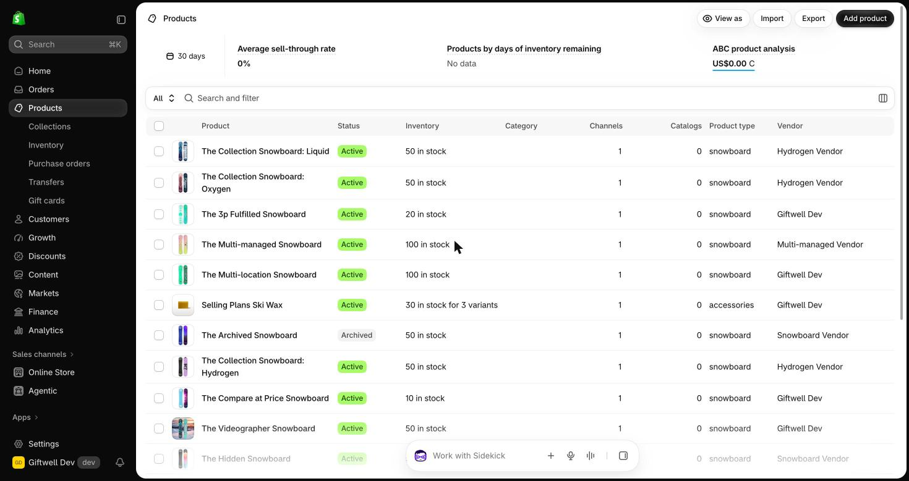

### 3. Scaffold the app
Shopify's React Router template in TypeScript, created without interactive prompts so the step is repeatable:

```bash
shopify app init --name Giftwell --organization-id <org> \
  --template reactRouter --flavor typescript --auth-alias personal
```

What the template gives: an embedded admin app (React Router + Polaris), OAuth and session storage (Prisma + SQLite), webhooks, and an `extensions/` folder where the checkout extensions and Functions will live.

### Notes for later
- The template ships demo config (an example metaobject, a product metafield, a product price-change event and broad product scopes). It will be replaced with Giftwell's real scopes in phase 2: discounts, payment customizations and validations.

---

## Phase 2: Gift message + tiered discount (26 Nov 2026)

### Tiered discount (Shopify Function, Discount API)
Scaffolded with Shopify CLI (`shopify app generate extension --template discount --flavor vanilla-js`), then trimmed to the one target it needs: `cart.lines.discounts.generate.run`. The scaffold also adds a shipping-discount target, which I removed.

How it works:
1. The input query asks for each cart line's quantity, whether the product is tagged `giftwell-exclude` (via `hasAnyTag`), and the discount's configuration metafield (`$app.function-configuration`).
2. The Function adds up the units of every eligible product, picks the highest tier reached, and returns a `productDiscountsAdd` operation for every eligible line.
3. Tiers come from the metafield, e.g. `{"tiers":[{"minQuantity":2,"percentage":10},{"minQuantity":3,"percentage":15}]}`. If the metafield is missing it falls back to 10% and 15%. That is what lets the phase 5 settings page change the tiers without redeploying code.

Tested with 5 fixture carts run against the compiled WebAssembly through Shopify's function runner. Each test also checks the input against Shopify's schema:

| Test cart | Expected |
|---|---|
| 1 item | no discount |
| 2 units | 10% off |
| 3 units, one product excluded | 15% off the 2 eligible lines only |
| 4 units, custom tiers in the metafield | 25% off (custom tier) |
| discount without the product class | no discount |

### Gift message (Checkout UI extension)
A card right after the delivery address: a gift icon, "Sending this as a gift?" and a short subtitle, then a "Yes, this order is a gift" checkbox. Ticking it turns the card a soft grey and opens a message box limited to 250 characters. Below the box, a green check confirms "Gift message saved", and a live count turns amber when 20 characters are left. The gift icon is blue (info) and turns green once the box is ticked.

Checkout extensions can't use custom CSS: Shopify keeps checkout consistent with each store's branding. So the styling is done entirely with Polaris components (`s-box` border, radius and background, `s-icon`, `s-text` types and tones). Colour works the same way: components take tones such as info, success and warning, and the actual colours come from each store's checkout branding, so the card always matches the store. The first version was a plain checkbox; I restyled it into the card after a review. Labels are translated (English and French).

**Where the message is stored:** Shopify now marks cart attributes (`applyAttributeChange`) as deprecated and recommends cart metafields. So the extension writes the cart metafield `$app.gift_message`, and an order metafield definition in `shopify.app.toml` with `cart_to_order_copyable = true` copies it onto the order when it is placed. The merchant sees it on the order page as "Gift message".

### App home page
Replaced the template's demo page with a Giftwell home: it shows the tiers and whether the discount is active, with an **Activate tiered discount** button that runs `discountAutomaticAppCreate` with the Function handle and the tiers metafield. Also removed the template's demo scopes, metaobject, product metafield and product webhook; the only scope now is `write_discounts`.

### Problems and fixes
| Problem | Fix |
|---|---|
| `shopify app generate extension` failed calling `pnpm` | The template left a `pnpm-workspace.yaml` in an npm project. npm workspaces were already in `package.json`, so I removed the pnpm file. |
| `--flavor preact` / `typescript-react` rejected for checkout UI | The checkout template has a single Preact flavor in this CLI version; generating without `--flavor` works. |
| `applyAttributeChange` is deprecated | Switched to cart metafields plus a cart-to-order copyable order metafield definition. |
| Dev preview refused the Function: "Variable definitions are missing" | Input-query variables must be backed by metafields. The excluded tag is fixed, so it is now written inline in the query. |
| Cloudflare quick tunnel kept failing on repeated `shopify app dev` runs ("max tries reached") | Switched to `shopify app dev --use-localhost`, which uses a local certificate made with mkcert. |
| On localhost, the config was rejected: webhook URIs can't be `localhost`, and the order metafield needs `write_orders` | Paused the two template webhooks while developing on localhost (re-added before deploying), and added the `write_orders` scope. |
| The checkbox appeared twice in the dev preview | I had given the extension two placements: a fixed one after the delivery address and a movable block. Dev preview shows both, and a merchant who placed the block would also get two. Removed the block, keeping the single fixed spot next to the shipping details. |
| After a page reload, the card came back unticked and empty, although the message was saved | App-owned metafields are only read back when the extension requests them. Added `[[extensions.metafields]]` for `$app.gift_message` to the extension config; a reload now restores the message and the "saved" check. |
| The gift message didn't show on the first checkout I opened | Checkout UI extensions in development only render on a checkout opened with the `?dev=` preview parameter from the Dev Console, and the preview takes a moment to pick up a new extension. |

### Seen working on the dev store
The discount was activated through the app's Admin API connection (the same `discountAutomaticAppCreate` call as the home page button) and tested on a real checkout.

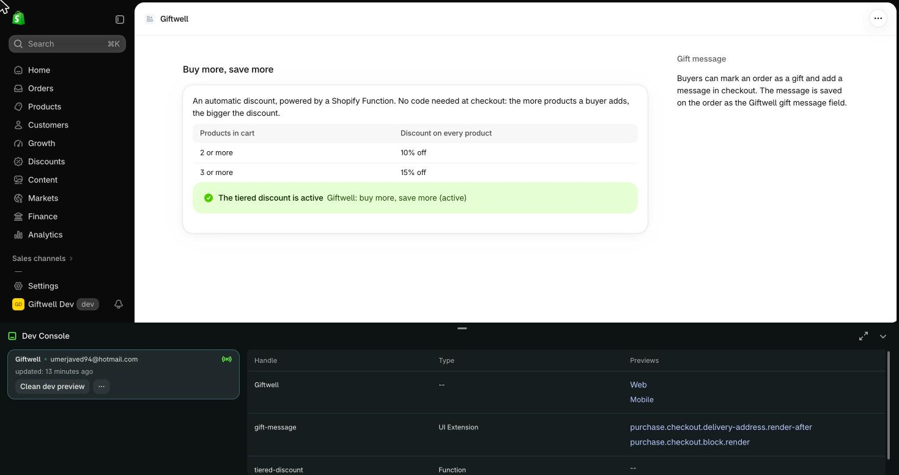

2 units: the Function applies "Buy 2+, save 10%" automatically, with no code entered ($49.90 to $44.92).

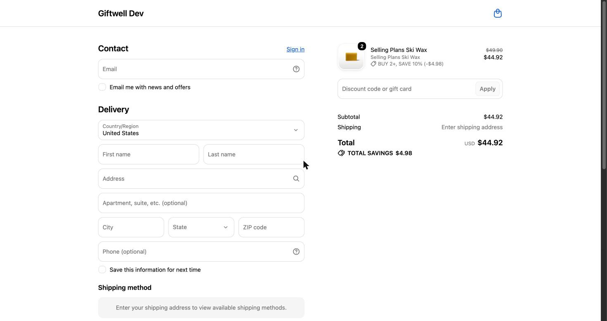

3 units: the 15% tier takes over ($74.85 to $63.63).


The gift card closed, as most buyers first see it:

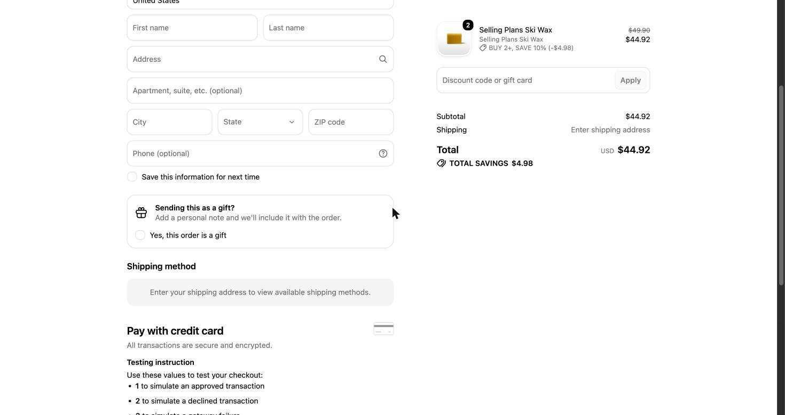

Ticked, with a message and the live character count, on the same checkout as the discount:

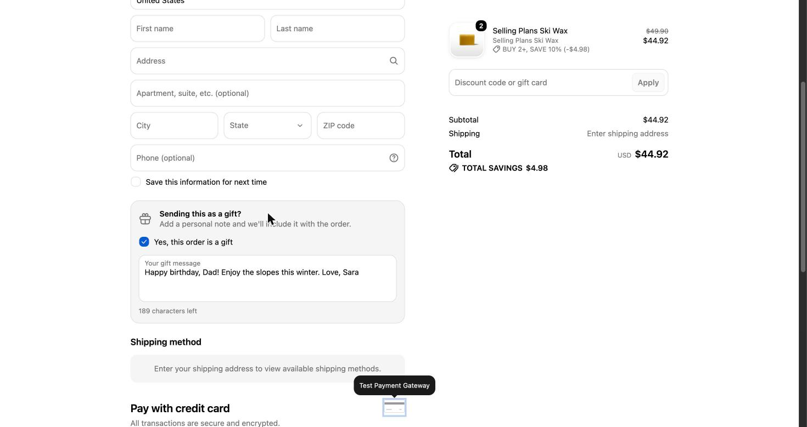

The dev log shows the Function's cost on a real checkout: **0.36 million instructions** per run, comfortably inside Shopify's Function limit.

### Checkout branding in the Boomer Gifts palette
Extensions can't set colours themselves; they use tones (info, success, warning) and the store's checkout branding decides the real colours. On Shopify Plus that branding is set through the Admin API, so I branded the dev store's checkout with the palette and fonts from the Boomer Gifts theme:

| Checkout role | Colour |
|---|---|
| Brand (Pay now and other buttons) | Maroon `#7B1C2A` |
| Accent (links, focus, checkboxes) | Gold `#D4920A` |
| Info tone (gift icon before ticking) | Gold `#D4920A` |
| Success tone (icon once ticked, "Gift message saved") | Maroon `#7B1C2A` |
| Order summary panel | Cream `#FBF8F2` |
| Fonts | Fraunces for headings, Inter for body text |

The mutation is saved in [`docs/checkout-branding.graphql`](../checkout-branding.graphql) so it can be re-run on any Plus or dev store. It needed the `write_checkout_branding_settings` scope.

Two details worth knowing:
- Setting a secondary font is not enough: checkout headings use the primary font unless `headingLevel1` to `headingLevel3` are pointed at `SECONDARY`.
- `checkoutBrandingUpsert` is deprecated in favour of `checkoutAndAccountsConfigurationUpdate`, which uses a numbered colour palette plus role mappings and needs another scope. The older mutation still works on API 2026-10 and gives the same result, so this one-off setup script uses it; moving it to the new API is a follow-up.

The same gift message extension, with no code changes, now in the brand:

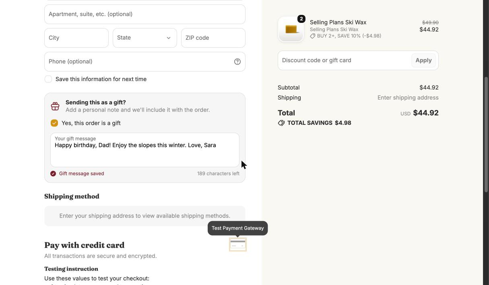

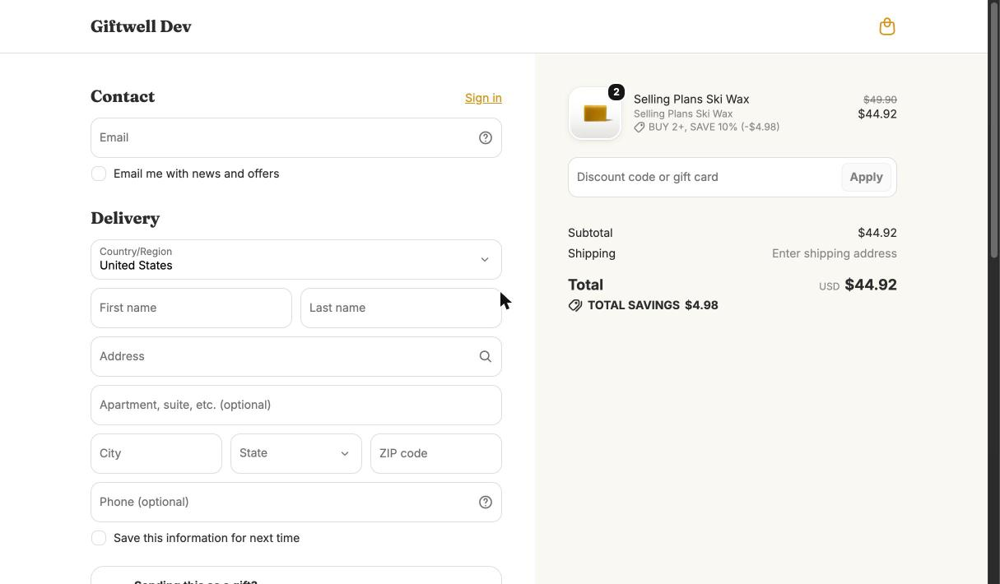

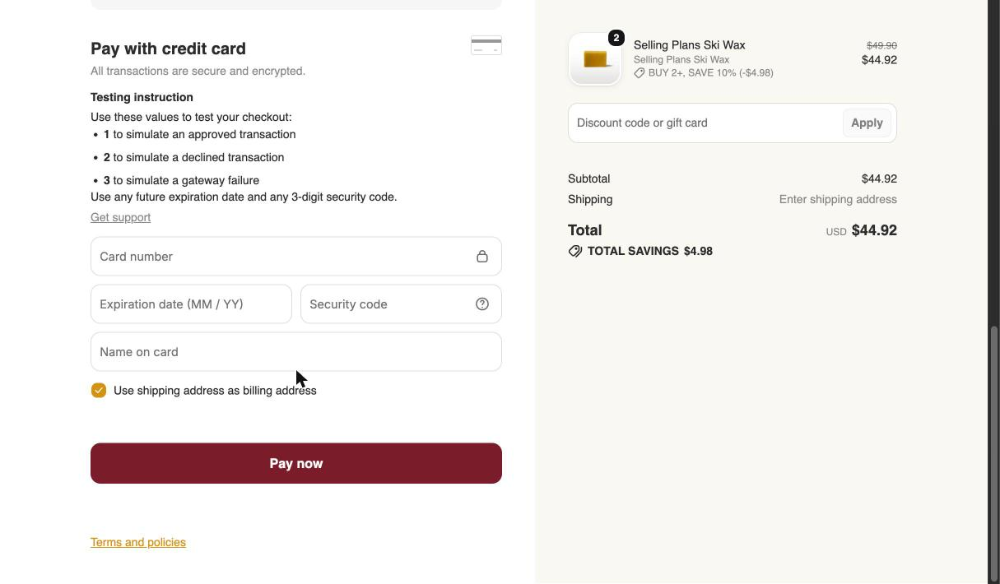

### End-to-end test order
A test order (#1001) placed through Shopify's test gateway confirms both pieces make it onto the order.

The discount Function's line appears on the order exactly as in checkout: "Buy 2+, save 10%", −$4.98.

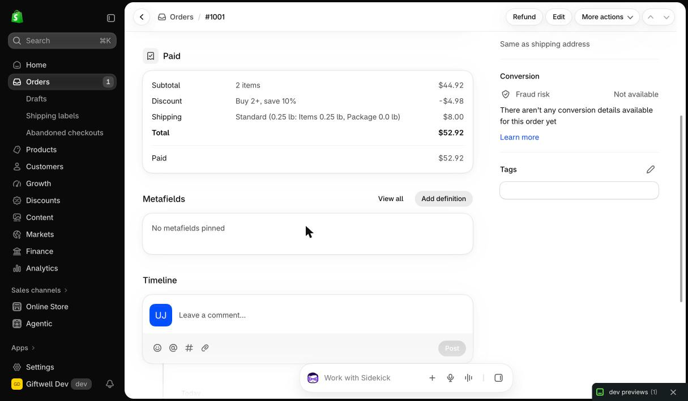

The gift message typed in checkout was copied from the cart metafield onto the order by the cart-to-order copyable definition, and shows in the admin as "Gift message":

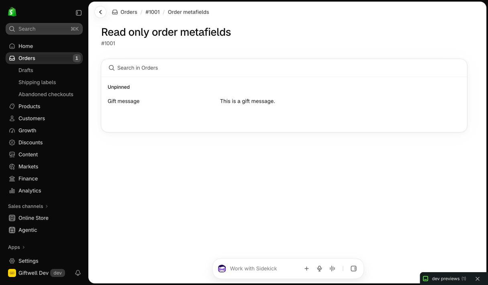

**What I learned from it:**
- The order API is gated behind Shopify's protected customer data rules, so the app can't read orders until that access is declared (even on a dev store). I verified the message in the admin instead; declaring that access is only needed once the app reads orders itself.
- Because the field is app-owned and read-only for the merchant, it's tucked away under Metafields → View all → View read only metafields. That's three clicks for something a packer needs at a glance. Next improvement: an admin order block extension that shows the gift message right on the order page.

Phase 2 is complete.

### Reload question, resolved
Re-tested at the start of phase 3 on one checkout: tick the box, type a message, reload the same checkout. The message, the ticked box and "Gift message saved" all come back. The earlier empty cards came from opening a fresh cart link each time, which starts a new cart with no metafields. It was not a bug in the extension.

---

## Phase 3: Hide cash on delivery + max per product (26 Nov 2026)

Two more Shopify Functions, both scaffolded with Shopify CLI in JavaScript and configured through a JSON metafield (`$app.function-configuration`) on their owner, like the discount.

### Hide cash on delivery (Payment Customization API)
If the order total is above `maxOrderTotal` (default $200), the Function returns a `paymentMethodHide` operation for every payment method whose name contains one of `paymentMethodNames` (default "cash on delivery" and "cod").

The name match is whole-word and case-insensitive, so "COD" and "Cash on Delivery (COD)" match but a method like "Barcode Pay", which contains the letters "cod", is never hidden. One of the 5 fixture tests checks exactly that.

| Test cart | Expected |
|---|---|
| $150 | COD stays |
| $250 | only COD is hidden |
| exactly $200 | COD stays (the rule is "above") |
| custom limit $100 and custom method name | the named method is hidden |
| $500, store has no COD method | nothing to hide |

### Max per product (Cart and Checkout Validation API)
Adds up the units of each product across all its variants (3 red + 3 blue of one shirt is 6) and blocks checkout when any product is above `maxPerProduct` (default 5), with a message that names the product.

| Test cart | Expected |
|---|---|
| 5 of one product | allowed |
| 6 of one product | blocked |
| 3 + 3 of two variants of one product | blocked (6 in total) |
| custom limit of 2, 3 in the cart | blocked |
| a custom line item with no product | ignored |

### Activating them
Both were created through the Admin API with `paymentCustomizationCreate` and `validationCreate` (with `blockOnFailure: true`), each carrying its configuration metafield. New scopes: `write_payment_customizations` and `write_validations`.

### Seen working on the dev store
Max per product, on the cart page: trying to go from 5 to 6 is refused, with the Function's message shown under the quantity. The cart also shows the tiered discount ("Buy 3+, save 15%"), so that Function runs on the cart page as well as in checkout.

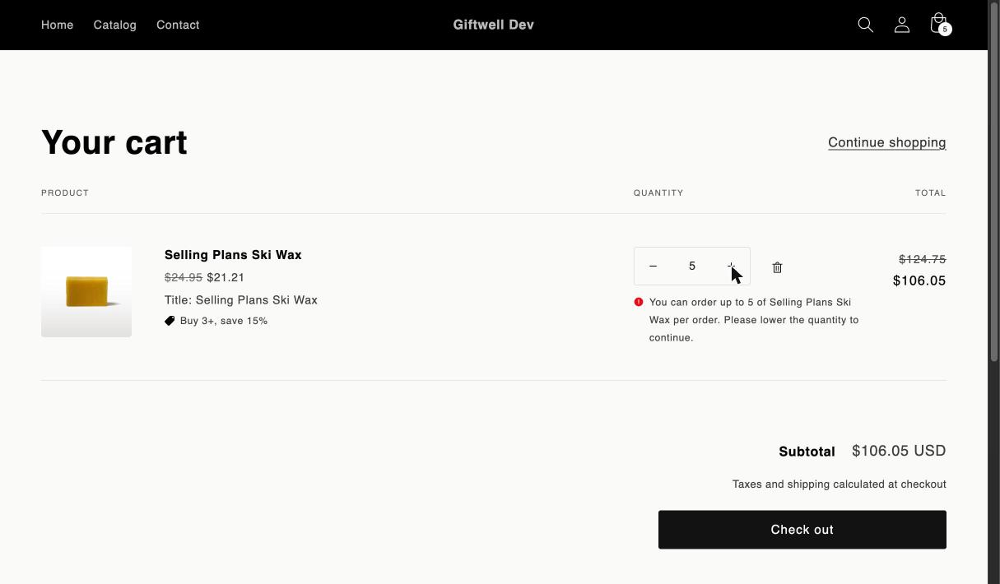

Hide cash on delivery: with a $52.92 total, "Cash on Delivery (COD)" is offered under the card form.

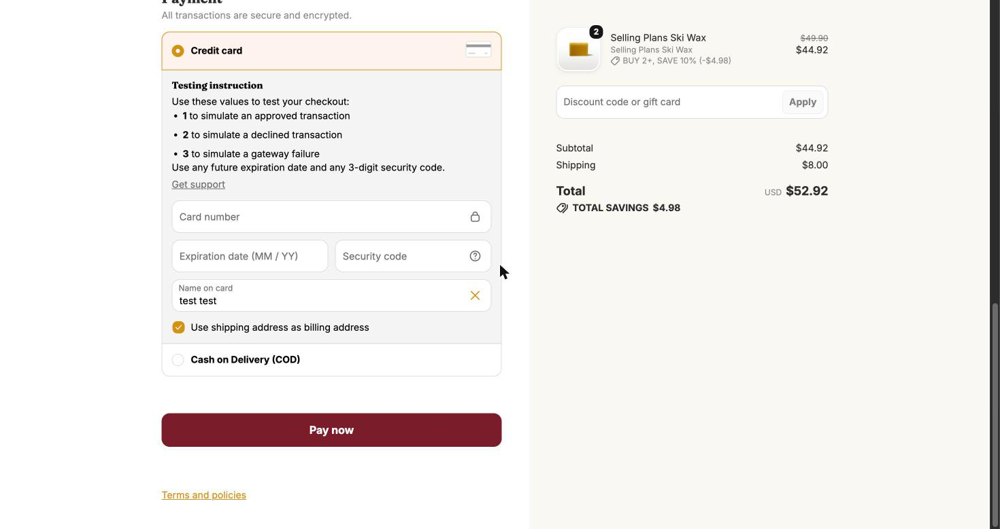

With a $600 snowboard, COD is gone and the section changes to "Pay with credit card", because only one method is left.


**Worth knowing:** the validation also runs when items are added to the cart, not only at checkout. A cart link for 6 units was refused before a cart was even created. That's good for protecting stock, but the buyer gets no message on that path. On the cart page the buyer does get the message, as shown above.

Phase 3 is complete.

---

## Phase 4: Gift wrap upsell, thank-you survey, admin gift details (26 Nov 2026)

Three extensions in three different places: checkout, the thank-you page and the Shopify admin.

### Gift wrap upsell (checkout UI extension)
A card under the cart lines (`purchase.checkout.cart-line-list.render-after`) offering gift wrap for $5. **Add** puts the gift wrap line in the order with `applyCartLinesChange`; the card then shows "✓ Gift wrap added" with a **Remove** button.

- The gift wrap product was created and published to the Online Store through the Admin API (`productCreate`, `productVariantsBulkUpdate`, `publishablePublish`): $5, untracked stock, tagged `giftwell-exclude`.
- Which product to add is a checkout editor setting (`variant_reference`), so a merchant can pick their own. Without it, the extension looks up the `giftwell-gift-wrap` product through the Storefront API.
- **The tag pays off:** with 2 ski wax and 1 gift wrap in the cart, the discount stays at "Buy 2+, save 10%". The gift wrap isn't counted towards the tier, exactly as the phase 2 Function intended.

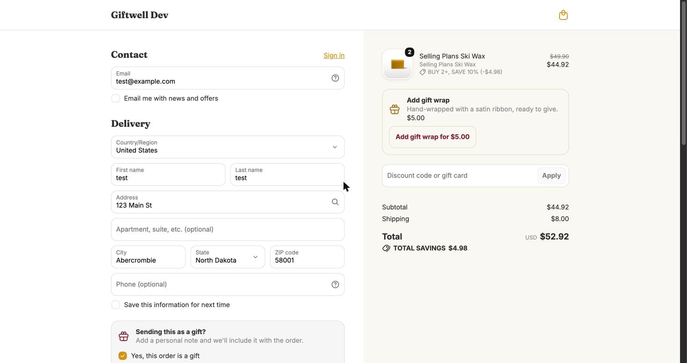

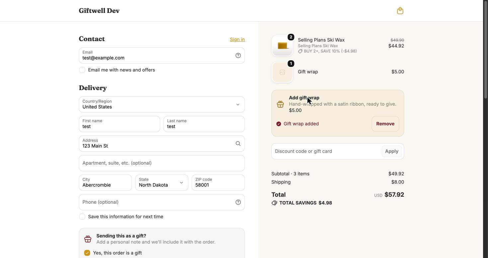

### Thank-you survey (checkout UI extension + app API + database)
"How did you hear about us?" on the thank-you page (`purchase.thank-you.block.render`). The thank-you page can't write to the order, so answers go to the app's own backend:

1. The extension gets a session token from Shopify (`sessionToken.get()`) and POSTs the answer and the order ID to `/api/survey`.
2. The route verifies the token with `authenticate.public.checkout`, which also handles CORS. The shop is taken from the verified token, never from the request body.
3. The answer is checked against the allowed list and saved with Prisma, one answer per order (an upsert on shop + order ID).
4. The extension remembers per order that it was answered, so a reload doesn't ask again.

Needs **network access** for the extension, enabled in the Dev Dashboard (Settings → Access requests).

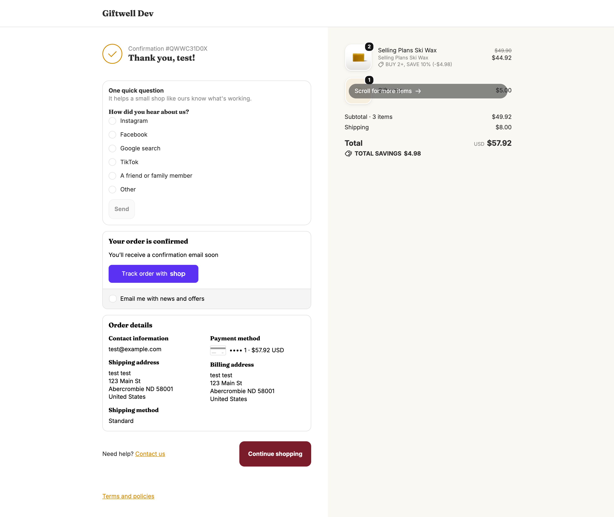

Saved in the database after sending:

| shop | orderId | answer |
|---|---|---|
| giftwell-dev.myshopify.com | gid://shopify/OrderIdentity/19046797017380 | instagram |

### Gift details on the admin order page (admin UI extension)
Added after the phase 2 test order showed the gift message was three clicks deep. A block on the order page (`admin.order-details.block.render`) reads the order's gift message metafield and line items through the Admin API and shows a "Gift order" badge, a "Gift wrap × N" badge and the message.

Reading orders needs **protected customer data** access. Giftwell asks for level 1 only (customer data, without names, emails, phone numbers or addresses), requested in the Dev Dashboard. Before that, the block correctly showed its error state.

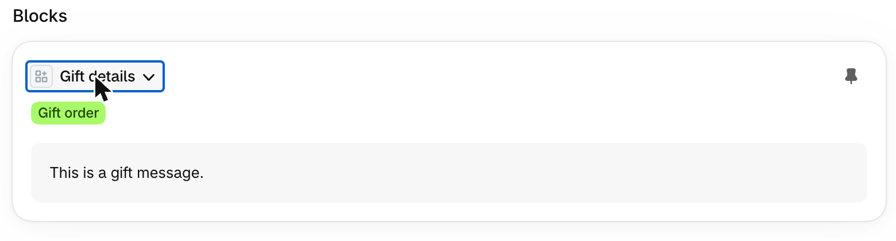

On order #1003, with gift wrap, both badges show (this test order's message is placeholder text):

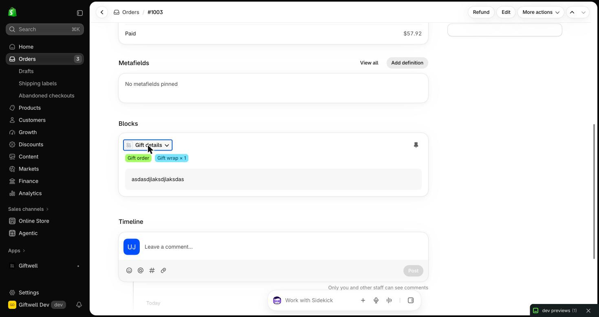

### Problems and fixes
| Problem | Fix |
|---|---|
| A shell variable named `UID` broke a script and left a placeholder extension ID | `UID` is read-only in zsh. Generated a new random extension ID in the same format. |
| `formatCurrency` rejected `currencyCode` | The option is `currency` (standard `Intl.NumberFormat` naming). |
| The admin block's type check failed with dozens of errors | They were all in the generated `dist/` bundle; excluded `dist` in its `tsconfig.json`. |
| Survey: "We couldn't send your answer" (1) | The server crashed on `new URL(sessionToken.dest)`. In checkout session tokens `dest` is a bare shop domain, not a URL. Now handled both ways. |
| Survey: still failing (2) | The running server held the database client from before the survey table existed. Restarting the dev server loaded the new client. |
| Admin block showed "Couldn't load the gift details" | Expected until protected customer data access was granted in the Dev Dashboard. |

Phase 4 is complete.

---

## Phase 5: Settings page (26 Nov 2026)

The app's home page is now where a merchant runs Giftwell: status at the top, three settings sections, and the survey results beside them.

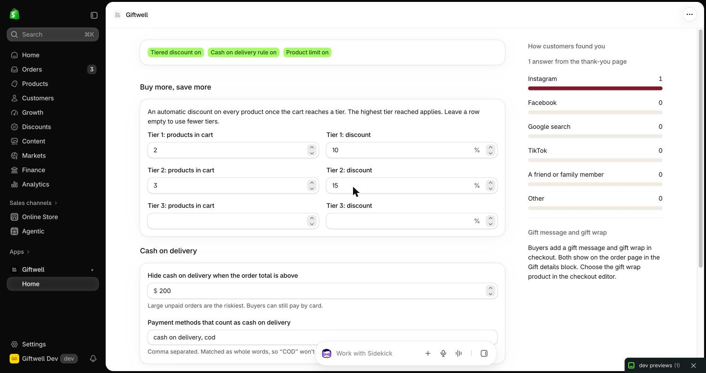

### What a merchant can change
| Section | Settings | Stored in |
|---|---|---|
| Buy more, save more | up to 3 tiers: minimum products and % off (empty rows are skipped) | the discount's `$app.function-configuration` metafield |
| Cash on delivery | the order total above which COD is hidden, and which payment method names count as COD | the payment customization's metafield |
| Limit per product | the most units of one product per order | the validation's metafield |

Each Function already reads its metafield on every run, so a save changes checkout immediately: no deploy, no code.

### How it's built
- **`app/lib/settings.ts`**: pure parsing and validation of the form (whole numbers, 1–100%, a tier quantity of at least 2, no duplicate tiers, a COD limit of 0 or more, rounded to cents). Covered by **7 unit tests** (`app/lib/settings.test.ts`).
- **`app/lib/giftwell.server.ts`**: one Admin API query reads all three Functions' owners and metafields, finding Giftwell's own by title. Saving updates the existing metafields in one `metafieldsSet` call, renames the payment customization and validation so their titles in the admin match the numbers, and creates anything missing. On a fresh install, a single Save sets everything up.
- **The page** uses Shopify's App Bridge save bar (`data-save-bar` on the form): the standard "Unsaved changes, Discard / Save" bar appears as soon as a field changes, with a discard confirmation. Field errors from the server show inline under the field that caused them.
- **Survey results**: the answers are grouped with Prisma and drawn as bars in the brand maroon, with the latest "Other" replies listed under them.

### Seen working on the dev store
Adding a third tier (5 products, 20% off) brought up the save bar:

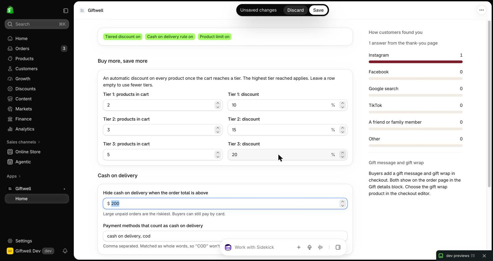

After saving, the page confirms and reloads the stored values from Shopify:

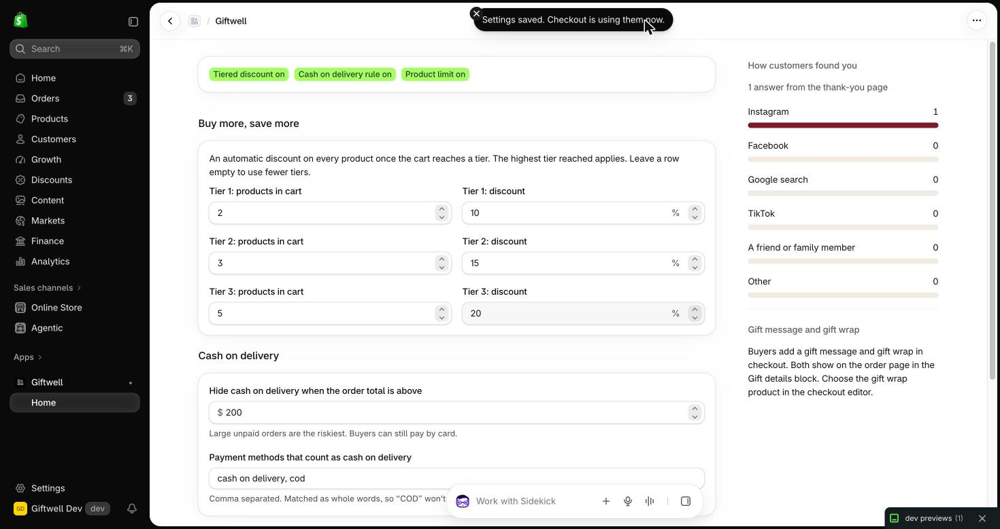

And checkout uses it at once: 5 snowboards get "Buy 5+, save 20%", $3,149.75 down to $2,519.80.

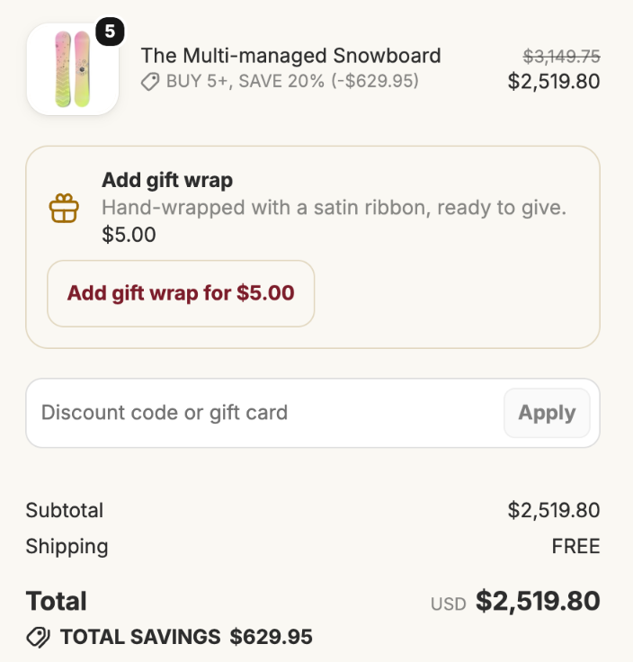

### Problem met
| Problem | Fix |
|---|---|
| The 5-unit test cart came out as 4 units at 15% | Not a Giftwell bug: the test orders had used up that ski wax variant's stock, so Shopify trimmed the cart. Retested with a product that has 100 in stock. |

Phase 5 is complete.

---

## Phase 6: Showcase (26 Nov 2026, in progress)

- **README** rewritten for clients and developers: feature table, screenshots, an architecture diagram, how settings and data flow, tests, project structure and setup steps.
- **Case study** added to umerconnects.com (`/work/giftwell-shopify-checkout-extensibility`), built with the site's own generator and linked from the Custom apps and integrations service page.
- **CV entry** written up with verified facts and ready-to-use bullets.
- Still to do: a Rust version of one Function with a speed comparison, and a fresh order screenshot with a real gift message.
